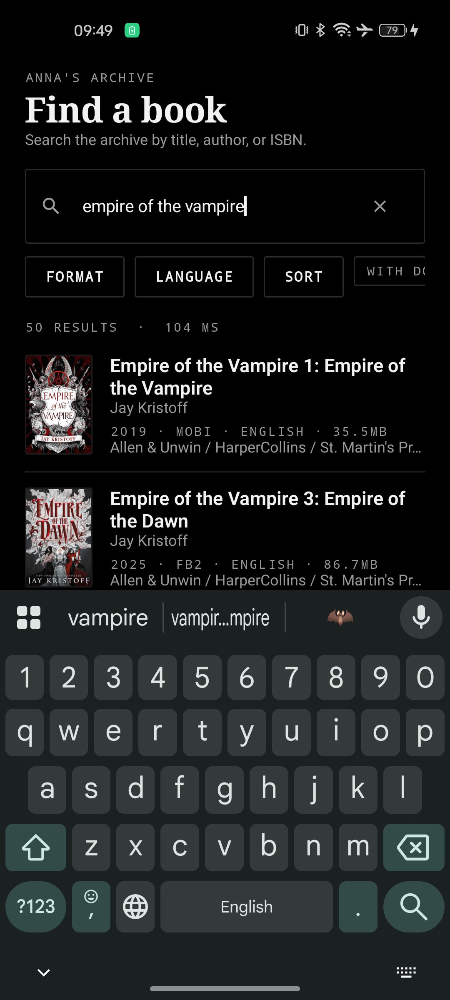
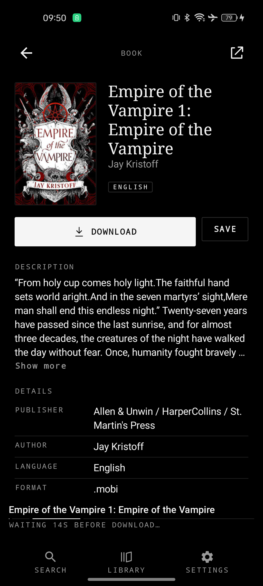
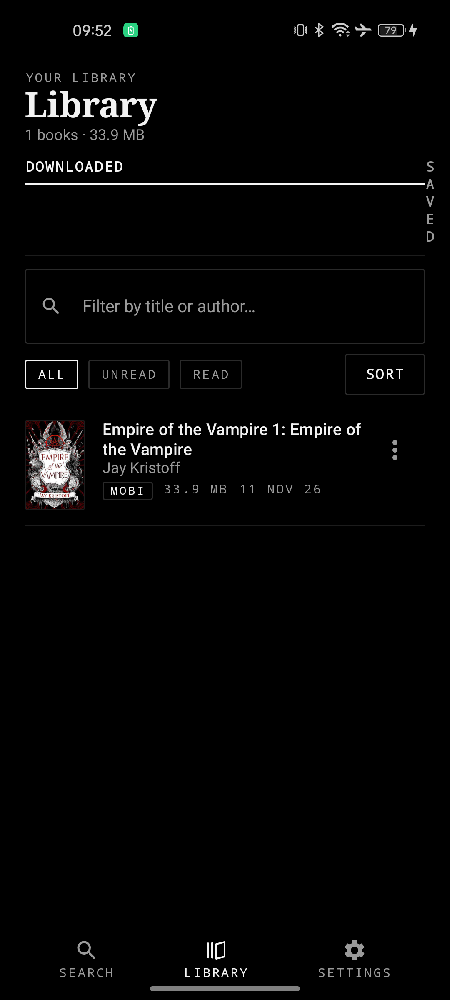
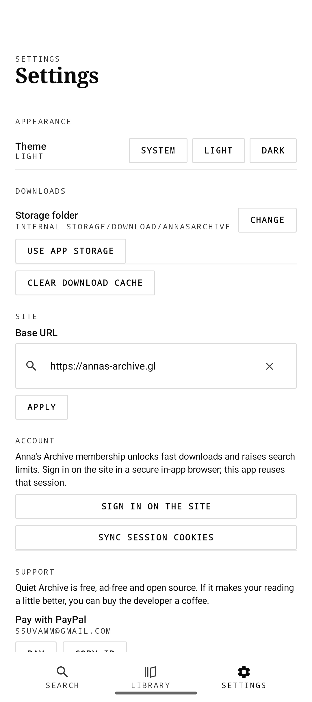
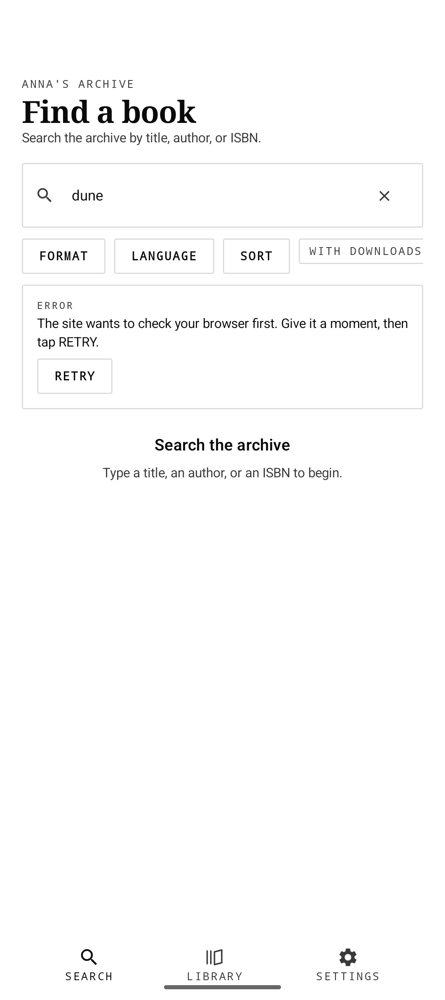
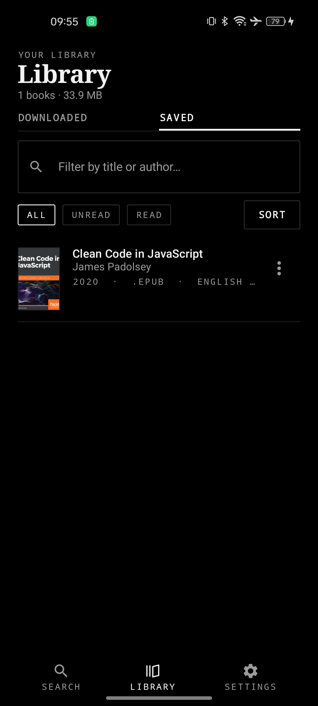
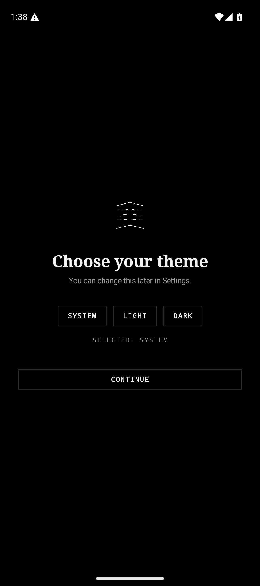
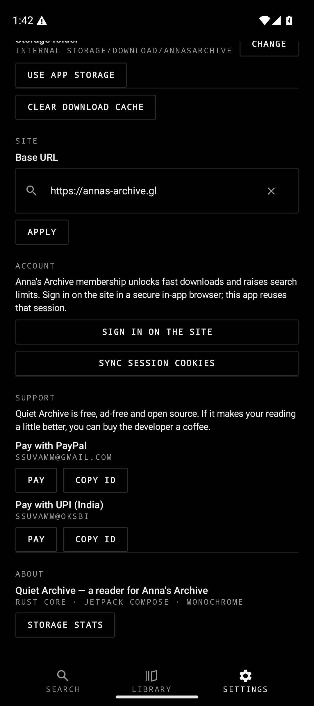
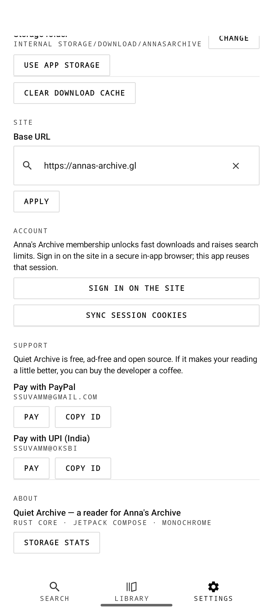

<p align="center">
  
</p>

<h1 align="center">Quiet Archive</h1>

<p align="center">
  A fast, quiet Android reader for <a href="https://annas-archive.gl">Anna's Archive</a> —
  monochrome, ad-free, open source.
</p>

<p align="center">
  <a href="../../releases/latest"></a>
  <a href="../../actions/workflows/build.yml"></a>
  <a href="LICENSE"></a>
  <a href="https://github.com/ssuvamm/quiet-archive/releases"></a>
</p>

<p align="center">
  
  
  
  
</p>

---

Anna's Archive is a wonderful thing, but its website is not a phone app. Quiet Archive is a
small, fast native client for it: search, read the details, download the file into your own
folder, and keep it in your library. No ads, no trackers, no colour — just black and white,
in light and dark.

## Features

**Finding books**
- Live search against Anna's Archive, relevance sorted, 50 results per page
- Infinite scroll with the next page fetched before you reach the bottom
- Filters for format, language and sort order, plus a "with downloads" chip
- Every result shows title, authors, year, format, language, size and publisher

**Reading the details**
- Cover, expandable description and a full details table (publisher, author, language, format,
  size, year, MD5)
- The site's download list, each entry classified as fast (members), slow (guest friendly) or
  external (mirrors, opened in your browser)

**Downloading**
- Built-in downloader that understands the site's waitlist and streams the file from the
  partner mirror
- Saves into a folder you choose with the system picker (or app storage)
- Correct file names and extensions, detected from the record and the file itself

**Your library**
- Downloaded books with format, size and date, read/unread marking, sort and filter
- A separate tab for bookmarks — saved books that are not downloaded yet

**Settings**
- Theme: system, light or dark
- Storage folder, base URL and cache controls
- Sign in on the site in an in-app browser; the session is handed to the app so fast
  downloads and higher search limits work

## Screenshots

<p align="center">
  
  
  
  
</p>

<p align="center">
  
  
  
</p>

## Install

Grab the latest APK from the [releases page](https://github.com/ssuvamm/quiet-archive/releases/latest).
It is a universal APK and runs on Android 8.0 (Oreo) and newer.

```
QuietArchive-1.0.0-universal.apk
```

## Build it yourself

Requirements: JDK 17, the Android SDK with NDK `27.1.12297006`, and Rust with
[`cargo-ndk`](https://github.com/cross-rs/cargo-ndk).

```bash
git clone https://github.com/ssuvamm/quiet-archive.git
cd quiet-archive

# Rust core for every ABI
cd rust
ANDROID_NDK_HOME=$ANDROID_SDK_ROOT/ndk/27.1.12297006 \
  cargo ndk -t arm64-v8a -t armeabi-v7a -t x86_64 -o ../app/src/main/jniLibs build --release
cd ..

# App
./gradlew assembleDebug          # debug APK
./gradlew assembleRelease        # signed release APK
```

Release signing is read from `keystore.properties` (git-ignored) or from environment
variables, so the same build works locally and in CI — see [docs/RELEASING.md](docs/RELEASING.md).

Tests:

```bash
cd rust && cargo test -p annas_core --lib
```

The parser tests run against real page dumps in `rust/test_data/`, so they keep up with the
live site. The live network test is ignored: it needs the browser-check cookies that only
exist inside the app's WebView session.

## Architecture

```
app/          Kotlin + Jetpack Compose UI (search, book, library, settings, onboarding)
rust/         Rust core: HTTP client, HTML parsers, downloader, library store (JNI)
docs/         Reference material (site samples, templates, releasing notes)
```

The Rust core is reached through `Native.kt` and returns JSON. It owns the network stack, the
parsers for the real site markup, the downloader and the on-device library.

### Getting past the browser check

`annas-archive.gl` sits behind DDoS-Guard, which fingerprint-checks plain HTTP clients on the
search and book paths. A real browser engine passes it, so the app keeps **one persistent
headless WebView** with a solved session (`data/WebFetch.kt`):

1. The session WebView loads the site once and clears the browser check.
2. Pages are then fetched with an in-page `fetch()` — same origin, browser cookies included.
3. If the guard answers anyway, the app performs a real navigation and harvests the DOM.
4. If it keeps blocking, the session is reset and retried with a fresh WebView.

WebView cookies are synced into the native core after every load, so plain HTTP (downloads,
covers) inherits the browser session. Sign-in works the same way: the in-app browser's cookies
are handed to the core.

## Support

Quiet Archive is free, ad-free and open source. If it makes your reading a little better, you
can buy the developer a coffee — PayPal or UPI, from the Support section in Settings.

## License

MIT — see [LICENSE](LICENSE).

This project is not affiliated with, endorsed by, or connected to Anna's Archive.
