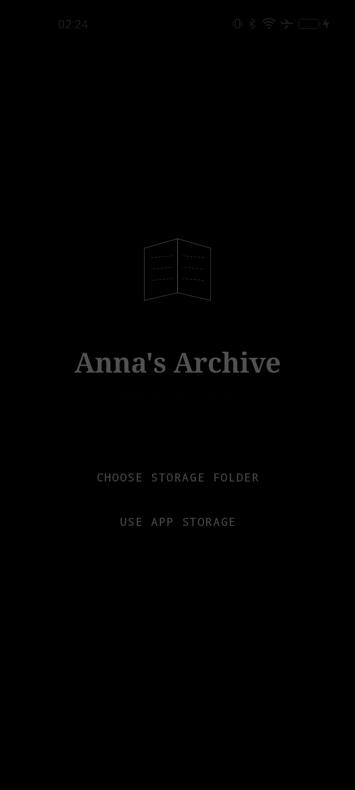

# Anna's Archive — Android client

A fast, monochrome (black & white) Android client for **Anna's Archive**, built with a
Rust core and Jetpack Compose. Light and dark themes, no gradients, no colour.

<p align="center">
  
</p>

## Features

- **Search** — fuzzy keyword search against the live site, relevance sorted, 50 results per
  page with infinite scroll and preemptive loading of the next page.
- **Rich result cards** — title, authors, year, format, language, size and publisher on every
  row, with covers.
- **Book pages** — cover, description (expandable), a full details table (publisher, author,
  language, format, size, year, MD5) and the site's download list, each link classified as
  `FAST` (member only), `SLOW` (guest friendly) or `EXTERNAL` (mirrors, opened in the browser).
- **Internal downloader** — resolves Anna's Archive waitlists, streams the file from the
  partner mirror and saves it to a folder you pick with the system picker.
- **Library** — downloaded books with format, size and date; filter by read/unread, sort, and
  a separate tab for bookmarks (saved but not downloaded).
- **Settings** — theme, storage folder, base URL, and an in-app sign-in browser that hands the
  session cookies to the native core (needed for fast downloads).

## Architecture

```
app/          Kotlin + Jetpack Compose UI (search, book, library, settings, onboarding)
rust/         Rust core: HTTP client, HTML parsers, downloader, library store (JNI)
docs/         Reference material (site samples, templates)
```

The Rust core is reached through `Native.kt` and returns JSON. It owns:

- `scrape_aa.rs` — parsers for the real search and book page markup
- `download.rs` — waitlist resolution, streaming download, validation, library records
- `lib.rs` — JNI surface (`search`, `book`, `startDownload`, `parseSearchHtml`, …)

### Getting past DDoS-Guard

`annas-archive.gl` sits behind DDoS-Guard, which fingerprint-checks plain HTTP clients on
`/search`, `/md5` and `/db`. A real browser engine passes it, so the app keeps **one
persistent headless WebView** with a solved session (`data/WebFetch.kt`):

1. The session WebView loads the site once and clears the browser check.
2. Pages are then fetched with an in-page `fetch()` (same origin, browser cookies included).
3. If the guard answers anyway, the app performs a real navigation and harvests the DOM.
4. If the guard keeps blocking, the session is reset and retried with a fresh WebView.

WebView cookies are synced into the native core after every load, so plain HTTP (downloads,
covers) inherits the browser session.

## Building

Requirements: JDK 17, Android SDK + NDK (`27.1.12297006`), Rust with `cargo-ndk`.

```powershell
$env:JAVA_HOME = "C:\Program Files\Java\jdk-17"
$env:Path = "C:\Program Files\Java\jdk-17\bin;$env:Path"
$gradle = "$env:USERPROFILE\.gradle\wrapper\dists\gradle-8.14.3-bin\*\gradle-8.14.3\bin\gradle.bat"
& $gradle assembleDebug
adb install -r app\build\outputs\apk\debug\app-arm64-v8a-debug.apk
```

The Gradle build cross-compiles the Rust core automatically (`buildRust` task); to build it
by hand:

```powershell
cd rust
$env:ANDROID_NDK_HOME = "$env:LOCALAPPDATA\Android\Sdk\ndk\27.1.12297006"
cargo ndk -t arm64-v8a -t armeabi-v7a -t x86_64 -o ../app/src/main/jniLibs build --release
```

## Tests

```powershell
cd rust
cargo test -p annas_core --lib
```

The parser tests run against real page dumps in `rust/test_data/` so they stay in sync with
the live site. The live network test is `#[ignore]`d — it needs valid guard cookies, which
only exist inside the app's WebView session.

---

Created in [T3 Code](https://t3.codes).
